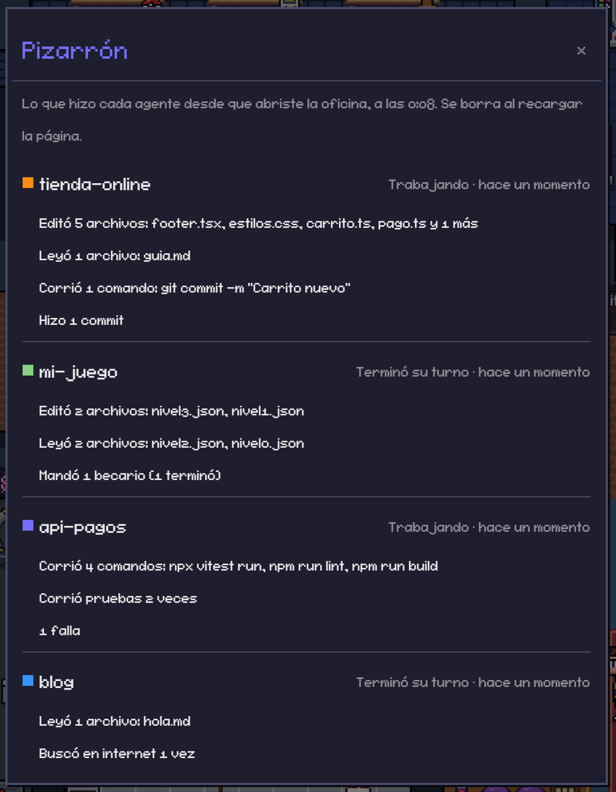

# Novedades

Lo nuevo de Javbots, lo más reciente arriba. El historial del proyecto original
(Pixel Agents) está en [CHANGELOG.md](CHANGELOG.md).

## 14 de octubre de 2026

- **Música de Spotify en la oficina** (opcional, con [Spicetify](https://spicetify.app)). Una columna a la
  derecha muestra la carátula, la canción, el artista y el tiempo, sin tapar nada de la oficina. En Becarios hay
  un tocadiscos que gira y suelta notitas mientras suena, y arriba un cuadro con la carátula en pixel art. Se
  instala desde Ajustes. Un clic en el tocadiscos esconde o muestra la columna. Detalles en
  [features/musica](features/musica/README.md).

## 12 de octubre de 2026

- **Pizarrón de actividad.** En la pared del pasillo hay un pizarrón con una rayita de color por agente, que crece
  entre más trabaja. Al darle clic, o con el botón nuevo de la columna de íconos, se abre un panel con lo que hizo
  cada agente desde que abriste la página: archivos que editó y leyó, comandos, commits, pruebas, búsquedas en
  internet, becarios que mandó y fallas. Lo que hace un becario cuenta para su jefe.

  

- **Ícono propio.** Un monitor con carita de bot: en la pestaña del navegador (que ahora se llama "Javbots"), en el
  acceso directo y en la consola del servidor en la barra de tareas de Windows.
- **Guía para agregar pixeles** ([docs/agregar-pixeles.md](docs/agregar-pixeles.md)): muebles, animaciones, luces,
  personajes y mascotas.
- **Librerías al día** con sus arreglos de seguridad (Fastify, React, Vite, entre otras).
- **Huevo de pascua en el Sótano.** Algo le pasa a Isaac si lo molestas lo suficiente (pista: once). Baila con una
  musiquita de 8 bits propia; si dejas un archivo `webview-ui/public/privado/isaac-dance.ogg` (esa carpeta no se
  sube), suena ese en su lugar.
- **Holograma animado.** Un mueble de tipo `HOLO_BUST` (ponlo con tu propio arte en una carpeta externa de pixeles)
  parpadea como los fantasmas Jedi y de noche alumbra a su alrededor.

## 11 de octubre de 2026

- **Luz para las mascotas de noche.** Cada mascota trae una lucecita que la sigue al caminar, del color que pongas en
  su `manifest.json` (`"lightColor"`).
- **Rayo de la cápsula de Light Labs** más largo, más brillante y constante; de noche ilumina alrededor.
- **README con capturas** y créditos para cada quien.

## 7 de octubre de 2026

- **Modo fiesta.** Cada turno terminado se festeja con un brinco y confeti; si trabajaron varios y todos acaban, hay
  fiesta en la sala de becarios (con luces de disco de noche).
- **Tiempo libre.** Después de 45 segundos sin trabajo, cada agente se pone a hacer algo: tele, consola, leer,
  meditar, café, Pac-Man o ver las estrellas de noche.
- **Botones nuevos:** Captura (foto PNG de toda la oficina) y "ver toda la oficina" para que quepa en la ventana.
- **Arreglos:** becarios en segundo plano que se iban antes de tiempo, agentes fantasma y agentes que se quedaban
  sentados.

## 5 de octubre de 2026

- **Oficina grande con nueve cuartos temáticos**, uno por tarea: Código (Matrix, Tron), Archivo Jedi, Light Labs
  (Mega Man), Senku (Dr. Stone), El Anillo, Taller (Volver al Futuro, Akira, Initial D), Aperture (Portal),
  Becarios y Sótano (The Binding of Isaac).
- **Personajes propios:** 6 jefes y 9 becarios. Cada jefe manda a sus propios becarios.

## 3 de octubre de 2026

- **Primera versión de Javbots**, sobre Pixel Agents de Pablo De Lucca.
- Todo en español; estado **"pensando"** cuando le escribes a una sesión (tu mensaje nunca sale de tu computadora);
  nombres completos de las carpetas.
- **Efectos:** sombras, personajes que respiran, muebles animados, partículas y ciclo de día y noche con luces.
- **Zonas por tarea:** cada personaje camina al cuarto de lo que está haciendo.
