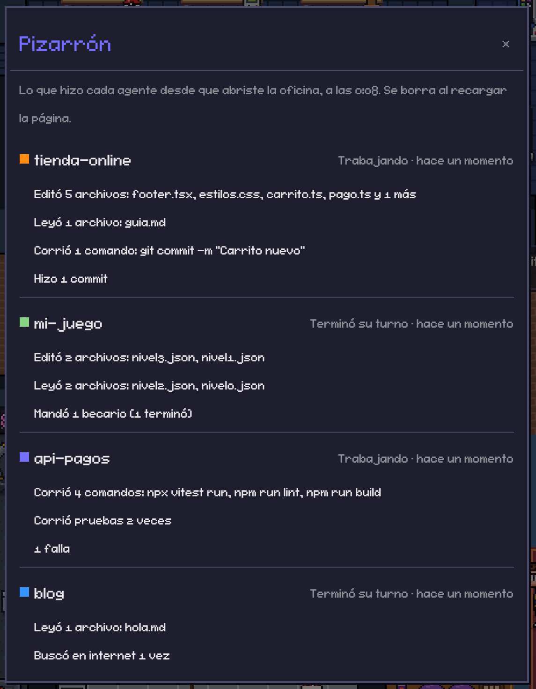

# Novedades

Lo nuevo de Javbots, lo más reciente arriba. El historial del proyecto original
(Pixel Agents) está en [CHANGELOG.md](CHANGELOG.md).

## 5 de noviembre de 2026

- **El piso Personal en cuadro.** Sus cuatro cuartos ya no van en una sola fila larga: quedan de 2×2 (agenda y
  freelance arriba, Directorio y Cerebro abajo), con puertas entre los de al lado y una puerta en la pared de en medio
  para bajar de cada cuarto al de abajo. Se ve completo sin tanto desplazarse.
- **Pantalla de perfil en el cuarto de freelance.** En la pared del cuarto de freelance (piso Personal), en lugar del
  póster del candado, hay una pantalla verde con tu tipo de personalidad, una barra por rasgo y un cursor que
  parpadea. Un clic abre el panel con los porcentajes, el rol, la estrategia y los datos curiosos. El resultado se lee
  de un archivo privado en tu carpeta de Javbots y no se sube a ningún lado; sin ese archivo la pantalla es una
  terminal vacía. Detalles en [features/perfil](features/perfil/README.md).
- **Avisos del pomodoro también en Windows.** Al terminar un bloque sale la notificación de Windows, aunque la oficina
  esté cerrada (antes solo avisaba en la Mac).

## 4 de noviembre de 2026

- **El pomodoro de la azotea ya funciona.** Un clic en el reloj de jitomate (o en el reloj de arena) del rincón de
  descanso abre el pomodoro: **Enfoque 25 min**, **Descanso 5 min** o **Descanso largo 15 min** (te lo sugiere después
  de 4 pomodoros), con **Pausar**, **Seguir** y **Parar**, y cuántos llevas hoy. Mientras corre, el jitomate de la
  pared cuenta hacia atrás (minutos arriba, segundos abajo), el letrero de **DESCANSO** solo se prende en los
  descansos y en el reloj de arena grande va cayendo la arena. El tiempo lo lleva la oficina, no la página: al
  terminar te llega un aviso de escritorio (en la Mac o en Windows) aunque la tengas cerrada, y si reinicias la oficina sigue donde iba. El
  siguiente bloque siempre lo empiezas tú.
  No depende de la azotea: sus piezas funcionan en cualquier oficina o piso donde las pongas con el editor, y el
  temporizador es uno solo para todas.
- **La oficina en su propia ventana, sin la llave a la vista.** El acceso directo Javbots abre la oficina en una
  ventana propia del navegador (Chrome o Edge en modo app): sin barra de direcciones y con su lugar en la barra de
  tareas. La llave de la oficina se quita de la dirección en cuanto carga la página y se recuerda en el navegador,
  así que ya no queda en el historial y F5 sigue funcionando.
- **La llave ya no cambia al reiniciar.** Antes, cada arranque inventaba una llave nueva y una pestaña abierta de
  antes se quedaba sin datos de GitHub, agenda, jardín, Directorio, conexiones y uso (solo seguía la música). Ahora
  la llave se guarda y es la misma en cada arranque. Si alguna vez quieres cambiarla: `pixel-agents --nueva-llave`.
- **Aviso de pestaña sin llave.** Si una pestaña no tiene la llave buena, la oficina lo dice arriba al centro en
  lugar de mostrar paneles vacíos: hay que abrirla otra vez desde el acceso directo.

## 3 de noviembre de 2026

- **Relojes digitales con la hora de verdad.** Los relojes de manecillas se cambiaron por digitales: el de pared de la
  planta baja (cyan, horas arriba y minutos abajo), el de latón del Directorio (ámbar) y el jitomate del rincón de
  descanso (pantalla roja). Marcan la hora real en formato de 24 horas, igual que el reloj del centro de mando, cuyos
  dos puntos ahora parpadean.
- **La letra en un globito, en todos los pisos.** Mientras suena una canción con letra sincronizada, la línea que se
  canta sale en un globo de diálogo encima del reproductor del piso que estás viendo, y cambia al ritmo de la canción;
  entre líneas, y si la canción es instrumental, sale una nota ♪. Si el reproductor no se ve en pantalla, un globito
  chico se queda arriba al centro. El piso Personal (en el centro de mando de la agenda) y el Roof garden (en la
  terraza, junto a la pérgola) ya tienen su propia rockola: la misma pieza de la sala de música, con su menú de
  estilos. Se apaga en **Ajustes → Globito con la letra en cada piso**.
- **Azotea con jardín.** Un piso nuevo que siempre va hasta arriba del edificio (botón **R** del elevador, "Roof garden"), aunque
  se agreguen más pisos. Su panel lleva las plantas (con fotos, notas y sus cuidados: regar, abonar, limpiar y podar,
  cada cuántos días y a qué hora avisar), los pendientes de hoy con el botón **Hecho** y el inventario del jardín. El
  siguiente cuidado se calcula desde la última vez que de verdad se hizo. Los avisos van a un calendario "Plantas" y
  a una lista de Google Tasks "Jardín", y la oficina los mantiene de acuerdo: si palomeas la tarea o marcas Hecho, se
  agenda el siguiente; si pasa el día sin hacerse, se recorre a mañana. Desde el celular basta dejar notas ("ya regué
  la monstera") y fotos en una carpeta "Jardín" de Google Drive; lo que no se entienda queda en una bandeja para
  acomodarlo con un clic. Cuando falta algo del inventario, aparece "Comprar…" en tus tareas. Una planta con el riego
  atrasado se ve sedienta.
- **Elevador nuevo, con todos los botones.** El elevador ahora es una placa de acero con remaches arriba a la
  izquierda: una pantallita de LED dice el piso donde estás (con ▲ o ▼ si estás arriba o abajo de la Planta baja) y
  abajo viene su nombre ("1 · Personal"). Los botones de piso son redondos, de dos en dos, y el tuyo se ve prendido.
  Con varias oficinas, los edificios van arriba de la pantallita, cada uno con su foquito. Debajo de una ranura viven
  los botones que antes estaban sueltos en la columna: editar la oficina, día y noche, pizarrón, captura, ver toda la
  oficina y ajustes. El acercar y alejar quedó aparte, chiquito, abajo a la derecha.
- **Pisos y elevador.** Cada oficina es un edificio con pisos: el plano de siempre es la **Planta baja**, donde viven
  los agentes, y una función o un paquete puede agregar pisos con su propio plano (sin agentes). Un **elevador** a la
  izquierda, con botones como los de uno de verdad (S, PB, 1, 2… y el nombre del piso), lleva de un piso a otro: el
  piso donde estás se ve prendido y los edificios van arriba del panel (reemplaza los botones de oficina de arriba a
  la derecha). La página pide un piso con `?piso=` y el navegador recuerda el último de cada oficina; el editor
  guarda el piso que estás viendo. Con un solo edificio y un solo piso, el elevador no sale y todo se ve como antes.
- **Javbots 2.0.** La esquina de la oficina ya dice v2.0 y, al darle clic, las novedades salen en español: varias
  oficinas con sus perfiles, paquetes privados, agentes que trabajan en su escritorio, uso de Claude, música y
  conexiones. "Ver en GitHub" lleva a esta página.
- **Paquetes privados**: una carpeta `privado/<paquete>/` (fuera de git) puede agregar oficinas, funciones, muebles y
  personajes sin tocar el motor. Un paquete también puede poner personal que camina por la oficina, actividades de
  tiempo libre (hasta una siesta: la cama se ve con alguien dormido), luces de sus muebles y su propio elenco de jefes
  y becarios. Sin paquete, Javbots se ve y funciona igual.
- La **barra de uso** muestra solo los perfiles de Claude Code de la oficina que estás viendo, el suyo primero.
- **Mac**: `scripts/mac/oficina.sh` abre y apaga la oficina, y `scripts/mac/crear-app.sh` crea la app del Dock.
- **Tablero de conexiones** en el Sótano: un rack con un foco por cada servicio de fuera con el que habla la oficina
  (Spotify, LRCLIB, GitHub, Claude, Herdr…). Verde funciona, amarillo parpadea si hay que atenderlo, rojo si falta
  la llave o conectarlo y azul si es una idea. Un clic muestra la lista: para qué sirve cada uno, cómo entra y cuándo
  se usó. Detalles en [features/conexiones](features/conexiones/README.md).
- **Un solo reproductor** en la sala de música: el tocadiscos y la rockola ahora son el mismo mueble, y un clic deja
  escoger entre tocadiscos, rockola clásica, setentera o digital (y ocultar o mostrar la columna de música).
- La sala de música se aligera: el piano, la batería, las cajas de discos y la cabina de DJ se fueron a la bodega, y
  el amplificador de Marty tomó el lugar del piano. En el mostrador hay boletos de concierto nuevos.
- **Mis próximos conciertos**: un clic en los boletos del mostrador muestra los conciertos de tu Google Calendar
  (los eventos cuyo título empieza con `Concierto:`) y cuántos días faltan. El botón **Buscar conciertos** revisa
  Ticketmaster México con tus artistas más escuchados en Spotify, y lo que encuentra se agrega al calendario con un
  clic. Detalles en [features/conciertos](features/conciertos/README.md).
- **Una sola conexión con Google** para toda la oficina: te conectas una vez y aceptas Calendar y Tasks. Detalles
  en [features/google](features/google/README.md).
- **Cuarto de agenda** (centro de mando): un clic en la consola o en sus pantallas abre **Hoy y esta semana**, con
  los eventos de un calendario compartido de Google y tus tareas de Google Tasks, por día. Se agregan escribiendo
  (con botones para `Concierto:`, `Salida:`, evento o tarea) y siempre se confirma antes de guardar; las tareas se
  marcan como hechas con un clic y los choques de horario se avisan. El mapa de la semana, la lista de tareas y el
  radar del cuarto se prenden con tu agenda. Detalles en [features/agenda](features/agenda/README.md).

## 2 de noviembre de 2026

- **Sala de música** donde estaba el laboratorio de Portal: una tienda de discos retro con neón, estantes de discos
  y casetes, cajas de discos, sillón con audífonos, batería, piano, micrófono, bocinas, tele de karaoke y una cabina
  de DJ con el tocadiscos (que se mudó de Becarios junto con el cuadro de la carátula). Con guiños: el amplificador de
  Marty en _Volver al futuro_, la radio de _Portal_ y una guitarra de _Guitar Hero_.
- **Rockola con tres estilos**: clásica de los 50, setentera y digital. Un clic en ella y escoges cómo se ve; sus
  luces corren y la digital muestra la carátula de lo que suena.
- **Bodega** en el Sótano: un clic en el estante muestra, con miniaturas, todos los muebles que no están puestos en
  la oficina (y los personajes en pausa). "Sacar" abre el editor con el mueble listo para colocarlo; lo que borras
  vuelve solo a la bodega. Detalles en [features/bodega](features/bodega/README.md).

## 30 de octubre de 2026

- **La música sin Spotify abierto en la computadora.** La oficina se puede conectar a tu cuenta de Spotify
  (Ajustes → Música → Conectar con Spotify) y así ve lo que suena en el celular o en una bocina aunque el Spotify de
  la PC esté cerrado o en pausa. Con Spotify abierto y sonando aquí, la extensión sigue mandando como antes. Los
  botones de la música, también los de otras pantallas, funcionan igual por esa vía. Hace falta una app gratuita
  en el panel de desarrollador de Spotify; cómo, en [features/musica](features/musica/README.md).

## 25 de octubre de 2026

- **Sala de GitHub**, abajo de la sala de cómputo. Cada archivero es uno de tus repos y sube de nivel con los
  commits (madera, metal y oro), junta hojas encima y prende un foco verde si hubo push esta semana. En la pared,
  tu gráfica de contribuciones y un corcho con los PRs abiertos. Al pasar el mouse sale el nombre del repo; un clic
  abre la lista con enlaces. Los datos salen de `gh`. Detalles en [features/github](features/github/README.md).
- **Fable en el uso de Claude.** La barra de abajo, el tablero de Código (ahora con tres tubos: 5 horas, semana
  y Fable) y el detalle muestran el límite semanal de Fable cuando lo hay, y Fable siempre sale en la lista por
  modelo. Como la barra de estado de Claude Code no manda ese límite, la oficina le pregunta a Claude Code su
  `/usage` al abrirse y cada 5 minutos mientras está abierta (no abre sesión ni gasta).
- **La sala de cómputo tiene más vida**: piso de madera, 6 escritorios con su juguete cada uno (Groot, cubo
  Rubik, Game Boy…), plantas, lámpara de lava, pósters y una esquina de café con máquina de snacks y tapete.
- **Botones de la música en otras pantallas.** Una pantalla de la casa ya no solo ve lo que suena: también puede
  regresar, pausar, adelantar y subir o bajar el volumen del Spotify de la PC, por el mismo puerto de pantallas.
- **Volumen y tempo**: la extensión de Spotify ahora cuenta el volumen y los pulsos por minuto de la canción (para
  que las mascotas de otra pantalla se muevan al ritmo), y manda la carátula más grande. Hay que volver a
  instalarla desde Ajustes.

## 24 de octubre de 2026

- **La música en otras pantallas.** Javbots puede compartir lo que suena (canción, posición, letra y carátula)
  con otra pantalla de la casa, como una tablet, por un puerto aparte. Viene apagado; se prende con `screenPort`
  en `music.json`. Detalles en [features/musica](features/musica/README.md#pantallas-en-la-red-opcional).
- **La letra ya no se atrasa al adelantar la canción**: la extensión de Spotify avisa en cuanto la posición
  brinca (hay que volver a instalarla desde Ajustes).
- **Los agentes se quedan quietos trabajando.** Antes caminaban a otro cuarto cada vez que cambiaban de
  herramienta (leer, editar, correr un comando), y pasaban medio turno en el pasillo. Ahora trabajan todo el
  turno en su escritorio y lo que hacen se ve ahí mismo: chispas de 88 mph al terminar un comando, confeti con
  cada commit, lágrimas si algo falla. El permiso todavía los lleva con Senku. Al terminar se quedan en su
  lugar, y a los 45 s se van a la sala de descanso (tele, puffs y Pac-Man) en vez de pasear por toda la oficina.
- **Siempre se sabe quién trabaja en qué**: encima de cada agente que trabaja sale una etiqueta chiquita con lo
  que hace y cuánto lleva ("Editando App.tsx · 3 min").
- **Uso de Claude** (opcional): una barra abajo a la izquierda con los límites del plan (5 horas y semana) y, al
  hacer clic, lo que lleva cada agente (costo estimado, tokens y contexto). Los datos salen de la barra de
  estado de Claude Code. En el detalle sale lo que lleva cada modelo (Opus, Fable…). Detalles en
  [features/usage](features/usage/README.md).
- **Código creció**: ahora ocupa lo que eran Light Labs y Senku, con 7 puestos más. Las piezas de Mega Man se
  juntaron en una esquina y Senku quedó como rincón (ahí siguen yendo a pedir permiso). En la pared hay un
  **tablero de uso** con dos tubos que se llenan (5 horas y semana) y un clic abre el detalle.
- **Sala de cómputo de becarios**: una sala nueva a la derecha, con 9 computadoras, donde trabajan los becarios.
  Becarios (los sillones) queda para su descanso y la fiesta.
- **Nombres de pestaña de herdr**: si usas [herdr](https://herdr.dev), cada personaje lleva el nombre de su
  pestaña en vez del de la carpeta. Detalles en [features/herdr](features/herdr/README.md).

## 15 de octubre de 2026

- **Seis becarios nuevos.** Chell ahora también manda a **P-body y Atlas**, los robots del cooperativo de Portal 2
  (además de Wheatley). Y hay **comodines** que le sirven a cualquier jefe: **Toad**, un **Moogle** que flota y
  aletea, un **Stormtrooper** y un **guardia del Juego del Calamar**. Salen cuando el jefe ya mandó a todos sus
  becarios propios, en vez de repetir uno, y conservan sus colores.

## 14 de octubre de 2026

- **Música de Spotify en la oficina** (opcional, con [Spicetify](https://spicetify.app)). Una columna a la
  derecha muestra la carátula, la canción, el artista y el tiempo, sin tapar nada de la oficina. En Becarios hay
  un tocadiscos que gira y suelta notitas mientras suena, y arriba un cuadro con la carátula en pixel art. Se
  instala desde Ajustes. Un clic en el tocadiscos esconde o muestra la columna. Detalles en
  [features/musica](features/musica/README.md).
- **Letras de las canciones**: karaoke en la columna (la línea que se canta, resaltada) y un globito arriba del
  tocadiscos. Salen de Spotify y, si no hay, de [LRCLIB](https://lrclib.net). Mientras se buscan, Hunter y Tango
  corren por la columna.
- **Botones de reproducción** en la columna: anterior, pausa/play y siguiente. La música viene apagada en las
  computadoras sin Spicetify (se puede prender en Ajustes).

## 12 de octubre de 2026

- **Pizarrón de actividad.** En la pared del pasillo hay un pizarrón con una rayita de color por agente, que crece
  entre más trabaja. Al darle clic, o con el botón nuevo de la columna de íconos, se abre un panel con lo que hizo
  cada agente desde que abriste la página: archivos que editó y leyó, comandos, commits, pruebas, búsquedas en
  internet, becarios que mandó y fallas. Lo que hace un becario cuenta para su jefe.

  

- **Ícono propio.** Un monitor con carita de bot: en la pestaña del navegador (que ahora se llama "Javbots"), en el
  acceso directo y en la consola del servidor en la barra de tareas de Windows.
- **Guía para agregar pixeles** ([docs/agregar-pixeles.md](docs/agregar-pixeles.md)): muebles, animaciones, luces,
  personajes y mascotas.
- **Librerías al día** con sus arreglos de seguridad (Fastify, React, Vite, entre otras).
- **Huevo de pascua en el Sótano.** Algo le pasa a Isaac si lo molestas lo suficiente (pista: once). Baila con una
  musiquita de 8 bits propia; si dejas un archivo `webview-ui/public/privado/isaac-dance.ogg` (esa carpeta no se
  sube), suena ese en su lugar.
- **Holograma animado.** Un mueble de tipo `HOLO_BUST` (ponlo con tu propio arte en una carpeta externa de pixeles)
  parpadea como los fantasmas Jedi y de noche alumbra a su alrededor.

## 11 de octubre de 2026

- **Luz para las mascotas de noche.** Cada mascota trae una lucecita que la sigue al caminar, del color que pongas en
  su `manifest.json` (`"lightColor"`).
- **Rayo de la cápsula de Light Labs** más largo, más brillante y constante; de noche ilumina alrededor.
- **README con capturas** y créditos para cada quien.

## 7 de octubre de 2026

- **Modo fiesta.** Cada turno terminado se festeja con un brinco y confeti; si trabajaron varios y todos acaban, hay
  fiesta en la sala de becarios (con luces de disco de noche).
- **Tiempo libre.** Después de 45 segundos sin trabajo, cada agente se pone a hacer algo: tele, consola, leer,
  meditar, café, Pac-Man o ver las estrellas de noche.
- **Botones nuevos:** Captura (foto PNG de toda la oficina) y "ver toda la oficina" para que quepa en la ventana.
- **Arreglos:** becarios en segundo plano que se iban antes de tiempo, agentes fantasma y agentes que se quedaban
  sentados.

## 5 de octubre de 2026

- **Oficina grande con nueve cuartos temáticos**, uno por tarea: Código (Matrix, Tron), Archivo Jedi, Light Labs
  (Mega Man), Senku (Dr. Stone), El Anillo, Taller (Volver al Futuro, Akira, Initial D), Aperture (Portal),
  Becarios y Sótano (The Binding of Isaac).
- **Personajes propios:** 6 jefes y 9 becarios. Cada jefe manda a sus propios becarios.

## 3 de octubre de 2026

- **Primera versión de Javbots**, sobre Pixel Agents de Pablo De Lucca.
- Todo en español; estado **"pensando"** cuando le escribes a una sesión (tu mensaje nunca sale de tu computadora);
  nombres completos de las carpetas.
- **Efectos:** sombras, personajes que respiran, muebles animados, partículas y ciclo de día y noche con luces.
- **Zonas por tarea:** cada personaje camina al cuarto de lo que está haciendo.
- **Directorio** (cuarto nuevo del piso Personal): escribes qué necesitas, dónde y para cuándo, y un agente de
  Claude Code lo busca en internet con tus criterios: primero el servicio oficial o autorizado, luego negocios
  establecidos con reseñas reales, y descarta a quien no tenga negocio visible. El botón **Buscar** abre el agente en
  una pestaña de herdr con sus permisos normales; sin herdr, **Copiar encargo** da una línea para pegar en cualquier
  sesión. Los resultados llegan solos al panel, ordenados y con su porqué, con botones Contacté, Descartado y
  **Agendar** (pregunta "¿Lo agrego así?" antes de crear la cita en el calendario compartido). Los criterios se
  editan en el panel y hay juegos para técnicos, doctores y restaurantes. Detalles en
  [features/directorio](features/directorio/README.md).
- **Pisos y elevador.** Cada oficina es un edificio con pisos: el plano de siempre es la **Planta baja**, donde viven
  los agentes, y una función o un paquete puede agregar pisos con su propio plano (sin agentes). Un **elevador** a la
  izquierda, con botones como los de uno de verdad (S, PB, 1, 2… y el nombre del piso), lleva de un piso a otro: el
  piso donde estás se ve prendido y los edificios van arriba del panel (reemplaza los botones de oficina de arriba a
  la derecha). La página pide un piso con `?piso=` y el navegador recuerda el último de cada oficina; el editor
  guarda el piso que estás viendo. Con un solo edificio y un solo piso, el elevador no sale y todo se ve como antes.
- **Javbots 2.0.** La esquina de la oficina ya dice v2.0 y, al darle clic, las novedades salen en español: varias
  oficinas con sus perfiles, paquetes privados, agentes que trabajan en su escritorio, uso de Claude, música y
  conexiones. "Ver en GitHub" lleva a esta página.
- **Paquetes privados**: una carpeta `privado/<paquete>/` (fuera de git) puede agregar oficinas, funciones, muebles y
  personajes sin tocar el motor. Un paquete también puede poner personal que camina por la oficina, actividades de
  tiempo libre (hasta una siesta: la cama se ve con alguien dormido), luces de sus muebles y su propio elenco de jefes
  y becarios. Sin paquete, Javbots se ve y funciona igual.
- La **barra de uso** muestra solo los perfiles de Claude Code de la oficina que estás viendo, el suyo primero.
- **Mac**: `scripts/mac/oficina.sh` abre y apaga la oficina, y `scripts/mac/crear-app.sh` crea la app del Dock.
- **Tablero de conexiones** en el Sótano: un rack con un foco por cada servicio de fuera con el que habla la oficina
  (Spotify, LRCLIB, GitHub, Claude, Herdr…). Verde funciona, amarillo parpadea si hay que atenderlo, rojo si falta
  la llave o conectarlo y azul si es una idea. Un clic muestra la lista: para qué sirve cada uno, cómo entra y cuándo
  se usó. Detalles en [features/conexiones](features/conexiones/README.md).
- **Un solo reproductor** en la sala de música: el tocadiscos y la rockola ahora son el mismo mueble, y un clic deja
  escoger entre tocadiscos, rockola clásica, setentera o digital (y ocultar o mostrar la columna de música).
- La sala de música se aligera: el piano, la batería, las cajas de discos y la cabina de DJ se fueron a la bodega, y
  el amplificador de Marty tomó el lugar del piano. En el mostrador hay boletos de concierto nuevos.
- **Mis próximos conciertos**: un clic en los boletos del mostrador muestra los conciertos de tu Google Calendar
  (los eventos cuyo título empieza con `Concierto:`) y cuántos días faltan. El botón **Buscar conciertos** revisa
  Ticketmaster México con tus artistas más escuchados en Spotify, y lo que encuentra se agrega al calendario con un
  clic. Detalles en [features/conciertos](features/conciertos/README.md).
- **Una sola conexión con Google** para toda la oficina: te conectas una vez y aceptas Calendar y Tasks. Detalles
  en [features/google](features/google/README.md).
- **Cuarto de agenda** (centro de mando): un clic en la consola o en sus pantallas abre **Hoy y esta semana**, con
  los eventos de un calendario compartido de Google y tus tareas de Google Tasks, por día. Se agregan escribiendo
  (con botones para `Concierto:`, `Salida:`, evento o tarea) y siempre se confirma antes de guardar; las tareas se
  marcan como hechas con un clic y los choques de horario se avisan. El mapa de la semana, la lista de tareas y el
  radar del cuarto se prenden con tu agenda. Detalles en [features/agenda](features/agenda/README.md).

## 2 de noviembre de 2026

- **Sala de música** donde estaba el laboratorio de Portal: una tienda de discos retro con neón, estantes de discos
  y casetes, cajas de discos, sillón con audífonos, batería, piano, micrófono, bocinas, tele de karaoke y una cabina
  de DJ con el tocadiscos (que se mudó de Becarios junto con el cuadro de la carátula). Con guiños: el amplificador de
  Marty en _Volver al futuro_, la radio de _Portal_ y una guitarra de _Guitar Hero_.
- **Rockola con tres estilos**: clásica de los 50, setentera y digital. Un clic en ella y escoges cómo se ve; sus
  luces corren y la digital muestra la carátula de lo que suena.
- **Bodega** en el Sótano: un clic en el estante muestra, con miniaturas, todos los muebles que no están puestos en
  la oficina (y los personajes en pausa). "Sacar" abre el editor con el mueble listo para colocarlo; lo que borras
  vuelve solo a la bodega. Detalles en [features/bodega](features/bodega/README.md).

## 30 de octubre de 2026

- **La música sin Spotify abierto en la computadora.** La oficina se puede conectar a tu cuenta de Spotify
  (Ajustes → Música → Conectar con Spotify) y así ve lo que suena en el celular o en una bocina aunque el Spotify de
  la PC esté cerrado o en pausa. Con Spotify abierto y sonando aquí, la extensión sigue mandando como antes. Los
  botones de la música, también los de otras pantallas, funcionan igual por esa vía. Hace falta una app gratuita
  en el panel de desarrollador de Spotify; cómo, en [features/musica](features/musica/README.md).

## 25 de octubre de 2026

- **Sala de GitHub**, abajo de la sala de cómputo. Cada archivero es uno de tus repos y sube de nivel con los
  commits (madera, metal y oro), junta hojas encima y prende un foco verde si hubo push esta semana. En la pared,
  tu gráfica de contribuciones y un corcho con los PRs abiertos. Al pasar el mouse sale el nombre del repo; un clic
  abre la lista con enlaces. Los datos salen de `gh`. Detalles en [features/github](features/github/README.md).
- **Fable en el uso de Claude.** La barra de abajo, el tablero de Código (ahora con tres tubos: 5 horas, semana
  y Fable) y el detalle muestran el límite semanal de Fable cuando lo hay, y Fable siempre sale en la lista por
  modelo. Como la barra de estado de Claude Code no manda ese límite, la oficina le pregunta a Claude Code su
  `/usage` al abrirse y cada 5 minutos mientras está abierta (no abre sesión ni gasta).
- **La sala de cómputo tiene más vida**: piso de madera, 6 escritorios con su juguete cada uno (Groot, cubo
  Rubik, Game Boy…), plantas, lámpara de lava, pósters y una esquina de café con máquina de snacks y tapete.
- **Botones de la música en otras pantallas.** Una pantalla de la casa ya no solo ve lo que suena: también puede
  regresar, pausar, adelantar y subir o bajar el volumen del Spotify de la PC, por el mismo puerto de pantallas.
- **Volumen y tempo**: la extensión de Spotify ahora cuenta el volumen y los pulsos por minuto de la canción (para
  que las mascotas de otra pantalla se muevan al ritmo), y manda la carátula más grande. Hay que volver a
  instalarla desde Ajustes.

## 24 de octubre de 2026

- **La música en otras pantallas.** Javbots puede compartir lo que suena (canción, posición, letra y carátula)
  con otra pantalla de la casa, como una tablet, por un puerto aparte. Viene apagado; se prende con `screenPort`
  en `music.json`. Detalles en [features/musica](features/musica/README.md#pantallas-en-la-red-opcional).
- **La letra ya no se atrasa al adelantar la canción**: la extensión de Spotify avisa en cuanto la posición
  brinca (hay que volver a instalarla desde Ajustes).
- **Los agentes se quedan quietos trabajando.** Antes caminaban a otro cuarto cada vez que cambiaban de
  herramienta (leer, editar, correr un comando), y pasaban medio turno en el pasillo. Ahora trabajan todo el
  turno en su escritorio y lo que hacen se ve ahí mismo: chispas de 88 mph al terminar un comando, confeti con
  cada commit, lágrimas si algo falla. El permiso todavía los lleva con Senku. Al terminar se quedan en su
  lugar, y a los 45 s se van a la sala de descanso (tele, puffs y Pac-Man) en vez de pasear por toda la oficina.
- **Siempre se sabe quién trabaja en qué**: encima de cada agente que trabaja sale una etiqueta chiquita con lo
  que hace y cuánto lleva ("Editando App.tsx · 3 min").
- **Uso de Claude** (opcional): una barra abajo a la izquierda con los límites del plan (5 horas y semana) y, al
  hacer clic, lo que lleva cada agente (costo estimado, tokens y contexto). Los datos salen de la barra de
  estado de Claude Code. En el detalle sale lo que lleva cada modelo (Opus, Fable…). Detalles en
  [features/usage](features/usage/README.md).
- **Código creció**: ahora ocupa lo que eran Light Labs y Senku, con 7 puestos más. Las piezas de Mega Man se
  juntaron en una esquina y Senku quedó como rincón (ahí siguen yendo a pedir permiso). En la pared hay un
  **tablero de uso** con dos tubos que se llenan (5 horas y semana) y un clic abre el detalle.
- **Sala de cómputo de becarios**: una sala nueva a la derecha, con 9 computadoras, donde trabajan los becarios.
  Becarios (los sillones) queda para su descanso y la fiesta.
- **Nombres de pestaña de herdr**: si usas [herdr](https://herdr.dev), cada personaje lleva el nombre de su
  pestaña en vez del de la carpeta. Detalles en [features/herdr](features/herdr/README.md).

## 15 de octubre de 2026

- **Seis becarios nuevos.** Chell ahora también manda a **P-body y Atlas**, los robots del cooperativo de Portal 2
  (además de Wheatley). Y hay **comodines** que le sirven a cualquier jefe: **Toad**, un **Moogle** que flota y
  aletea, un **Stormtrooper** y un **guardia del Juego del Calamar**. Salen cuando el jefe ya mandó a todos sus
  becarios propios, en vez de repetir uno, y conservan sus colores.

## 14 de octubre de 2026

- **Música de Spotify en la oficina** (opcional, con [Spicetify](https://spicetify.app)). Una columna a la
  derecha muestra la carátula, la canción, el artista y el tiempo, sin tapar nada de la oficina. En Becarios hay
  un tocadiscos que gira y suelta notitas mientras suena, y arriba un cuadro con la carátula en pixel art. Se
  instala desde Ajustes. Un clic en el tocadiscos esconde o muestra la columna. Detalles en
  [features/musica](features/musica/README.md).
- **Letras de las canciones**: karaoke en la columna (la línea que se canta, resaltada) y un globito arriba del
  tocadiscos. Salen de Spotify y, si no hay, de [LRCLIB](https://lrclib.net). Mientras se buscan, Hunter y Tango
  corren por la columna.
- **Botones de reproducción** en la columna: anterior, pausa/play y siguiente. La música viene apagada en las
  computadoras sin Spicetify (se puede prender en Ajustes).

## 12 de octubre de 2026

- **Pizarrón de actividad.** En la pared del pasillo hay un pizarrón con una rayita de color por agente, que crece
  entre más trabaja. Al darle clic, o con el botón nuevo de la columna de íconos, se abre un panel con lo que hizo
  cada agente desde que abriste la página: archivos que editó y leyó, comandos, commits, pruebas, búsquedas en
  internet, becarios que mandó y fallas. Lo que hace un becario cuenta para su jefe.

  

- **Ícono propio.** Un monitor con carita de bot: en la pestaña del navegador (que ahora se llama "Javbots"), en el
  acceso directo y en la consola del servidor en la barra de tareas de Windows.
- **Guía para agregar pixeles** ([docs/agregar-pixeles.md](docs/agregar-pixeles.md)): muebles, animaciones, luces,
  personajes y mascotas.
- **Librerías al día** con sus arreglos de seguridad (Fastify, React, Vite, entre otras).
- **Huevo de pascua en el Sótano.** Algo le pasa a Isaac si lo molestas lo suficiente (pista: once). Baila con una
  musiquita de 8 bits propia; si dejas un archivo `webview-ui/public/privado/isaac-dance.ogg` (esa carpeta no se
  sube), suena ese en su lugar.
- **Holograma animado.** Un mueble de tipo `HOLO_BUST` (ponlo con tu propio arte en una carpeta externa de pixeles)
  parpadea como los fantasmas Jedi y de noche alumbra a su alrededor.

## 11 de octubre de 2026

- **Luz para las mascotas de noche.** Cada mascota trae una lucecita que la sigue al caminar, del color que pongas en
  su `manifest.json` (`"lightColor"`).
- **Rayo de la cápsula de Light Labs** más largo, más brillante y constante; de noche ilumina alrededor.
- **README con capturas** y créditos para cada quien.

## 7 de octubre de 2026

- **Modo fiesta.** Cada turno terminado se festeja con un brinco y confeti; si trabajaron varios y todos acaban, hay
  fiesta en la sala de becarios (con luces de disco de noche).
- **Tiempo libre.** Después de 45 segundos sin trabajo, cada agente se pone a hacer algo: tele, consola, leer,
  meditar, café, Pac-Man o ver las estrellas de noche.
- **Botones nuevos:** Captura (foto PNG de toda la oficina) y "ver toda la oficina" para que quepa en la ventana.
- **Arreglos:** becarios en segundo plano que se iban antes de tiempo, agentes fantasma y agentes que se quedaban
  sentados.

## 5 de octubre de 2026

- **Oficina grande con nueve cuartos temáticos**, uno por tarea: Código (Matrix, Tron), Archivo Jedi, Light Labs
  (Mega Man), Senku (Dr. Stone), El Anillo, Taller (Volver al Futuro, Akira, Initial D), Aperture (Portal),
  Becarios y Sótano (The Binding of Isaac).
- **Personajes propios:** 6 jefes y 9 becarios. Cada jefe manda a sus propios becarios.

## 3 de octubre de 2026

- **Primera versión de Javbots**, sobre Pixel Agents de Pablo De Lucca.
- Todo en español; estado **"pensando"** cuando le escribes a una sesión (tu mensaje nunca sale de tu computadora);
  nombres completos de las carpetas.
- **Efectos:** sombras, personajes que respiran, muebles animados, partículas y ciclo de día y noche con luces.
- **Zonas por tarea:** cada personaje camina al cuarto de lo que está haciendo.
