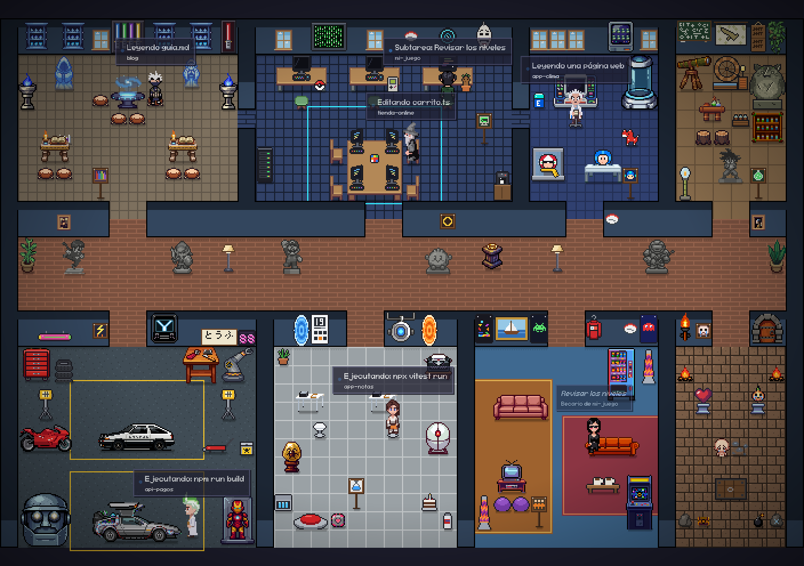
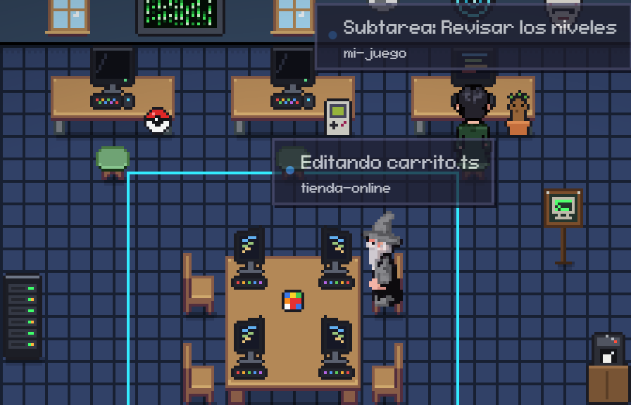
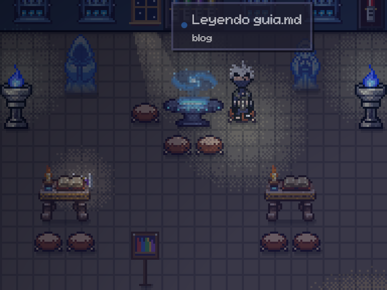
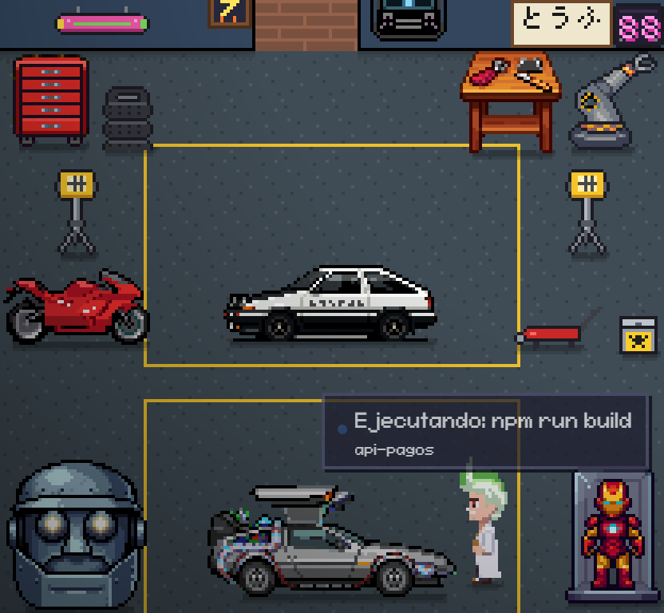
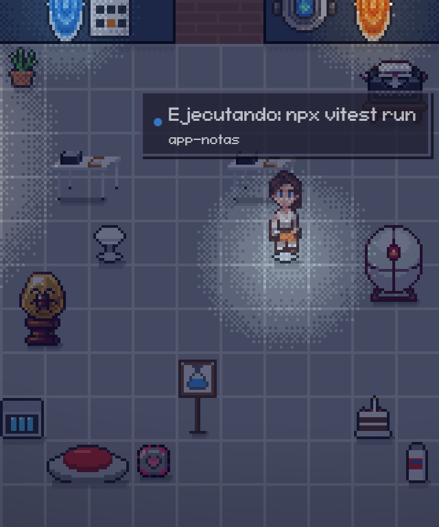
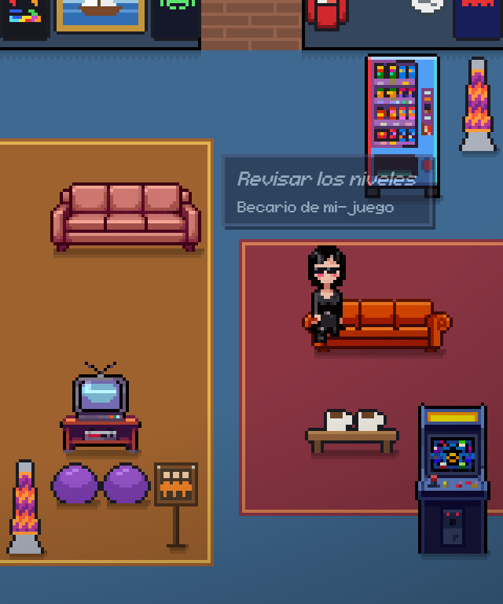
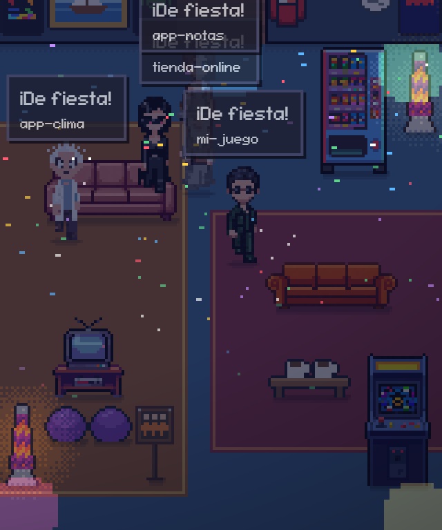
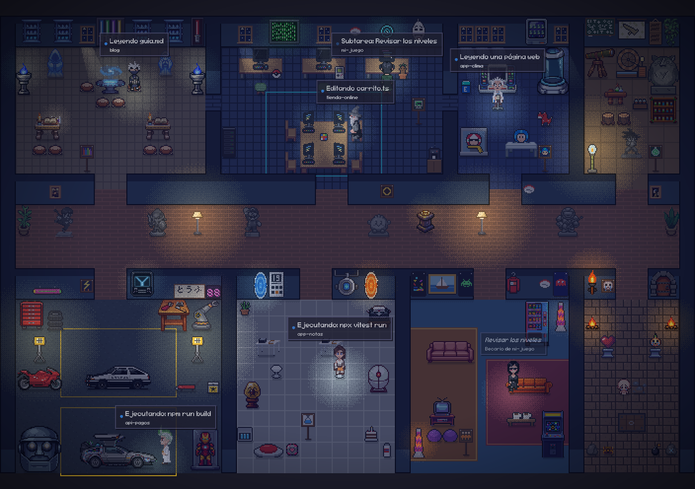

<div align="center">

# Javbots

**Una oficina en pixel art donde cada sesión de Claude Code es un personaje que trabaja, piensa,
pide permiso, descansa… y hace fiesta cuando todos terminan.**

Basado en [Pixel Agents](https://github.com/pablodelucca/pixel-agents) de Pablo De Lucca.



</div>

## ¿Qué es?

Abres tus sesiones de Claude Code como siempre y, en otra ventana, ves una oficina donde cada sesión es
un personaje. Lo que hace el personaje sale de lo que está haciendo la sesión **de verdad**: si edita
archivos, se sienta a teclear; si corre comandos, se va al taller; si busca en internet, se va al
laboratorio; si necesita tu permiso, te avisa con un globo.

Este proyecto **no empezó de cero**: es una versión propia de [Pixel Agents](https://github.com/pablodelucca/pixel-agents),
que es quien hizo la base (el servidor, los hooks, la oficina, el editor de planos y mucho más). Aquí le
cambiamos el idioma, el arte, los cuartos y le agregamos cosas nuevas. La documentación original está en
[docs/README-original.md](docs/README-original.md).

## Capturas

<table>
  <tr>
    <td width="50%"><br><b>Código</b> (Matrix y Tron): aquí se edita.</td>
    <td width="50%"><br><b>Archivo Jedi</b>: aquí se lee y se busca. De noche, con sus braseros.</td>
  </tr>
  <tr>
    <td><br><b>Taller</b> (Volver al Futuro, Akira, Initial D): aquí se corren comandos.</td>
    <td><br><b>Aperture</b> (Portal): aquí corren las pruebas.</td>
  </tr>
  <tr>
    <td><br><b>Becarios</b>: los sub-agentes trabajan aquí y luego regresan con su jefe.</td>
    <td><br><b>Fiesta</b>: cuando todos terminan, se juntan a bailar (de noche, con luces de disco).</td>
  </tr>
</table>

<div align="center">



*De noche se prenden las lámparas, las pantallas y la luz de la luna por las ventanas.*

</div>

## ¿Qué cambia respecto al original?

- **Todo en español**: la interfaz, los estados ("Editando carrito.ts", "Ejecutando: npm test") y los avisos.
- **Un cuarto por tarea**: cada personaje camina al cuarto de lo que está haciendo.

  | Cuarto | Homenaje a | Qué se hace ahí |
  | --- | --- | --- |
  | Código | Matrix, Tron | Editar archivos |
  | Archivo Jedi | Star Wars | Leer y buscar |
  | Light Labs | Mega Man | Buscar en internet (con el rayo de la cápsula) |
  | Laboratorio de Senku | Dr. Stone | Esperar tu permiso |
  | El Anillo | El Señor de los Anillos | Hacer commits |
  | Taller | Volver al Futuro, Akira, Initial D | Correr comandos |
  | Aperture | Portal | Correr pruebas |
  | Becarios | Los Simpson, Friends, arcades | Sub-agentes y descanso |
  | Sótano | The Binding of Isaac | Cuando algo falla (llorando) |

- **Personajes nuevos**: 6 jefes y 9 becarios. Cada jefe manda a sus propios becarios (los sub-agentes),
  que llegan junto a él, trabajan en su sala y al terminar regresan con él.
- **Estado "pensando"**: cuando le escribes a una sesión, su personaje se sienta con una nube de puntitos
  hasta que empieza a trabajar. El texto de tu mensaje **nunca** sale de tu computadora: el hook lo borra
  antes de mandarlo y solo avisa _que_ escribiste.
- **Nombres completos**: cada personaje muestra el nombre real de la carpeta de su proyecto.
- **Efectos**: sombras, personajes que respiran, muebles animados, partículas (vapor del café, chispas,
  confeti) y ciclo de día y noche con luces de verdad.
- **Tiempo libre**: después de 45 segundos sin trabajo, cada uno se pone a hacer algo: ver la tele, jugar,
  leer, meditar, ir por café, jugar Pac-Man o ver las estrellas de noche.
- **Modo fiesta**: cada turno terminado se festeja con un brinco y confeti; si trabajaron varios y todos
  terminan, hay fiesta en la sala de becarios.
- **Mascotas con luz**: puedes cargar tus propias mascotas y, de noche, cada una trae su lucecita del color
  que quieras (`"lightColor": "#8fd3ff"` en su `manifest.json`).
- **Botones nuevos**: foto de toda la oficina en PNG y "ver toda la oficina" para que quepa en la ventana.
- Arreglos: pruebas aisladas en Windows (ya no tocan tu configuración real), agentes fantasma que se quedaban
  sentados, sub-agentes en segundo plano que se iban antes de tiempo, y más.

## Cómo usarlo

Necesitas [Node.js](https://nodejs.org) 20 o más nuevo (recomendado 22+) y Claude Code.

```bash
git clone https://github.com/DeveloperJGV/Javbots.git
cd Javbots
npm install
npm run compile
node dist/cli.js --port 3100
```

Abre la dirección que imprime en tu navegador. Trae un token: **trátalo como contraseña**.

La primera vez, la oficina te pide permiso para agregar hooks a `~/.claude/settings.json` (así se entera al
instante de lo que hace cada sesión). Antes de tocar ese archivo guarda un respaldo, y lo puedes quitar
cuando quieras desde Ajustes. Si no das permiso, funciona igual leyendo los registros de las sesiones, solo
que un poco más lento.

Para tener el comando `pixel-agents` en cualquier terminal: `npm link`.

### Pruebas

```bash
npm test          # servidor + página
npm run e2e       # Playwright (navegador)
```

### Tus propios muebles y mascotas

En **Ajustes → Agregar carpeta de pixeles** puedes cargar una carpeta tuya con muebles, personajes o mascotas.
El formato está en [docs/external-assets.md](docs/external-assets.md).

## Créditos

Cada quien su crédito:

- **[Pixel Agents](https://github.com/pablodelucca/pixel-agents)**, de **Pablo De Lucca**: todo el proyecto
  base (servidor, hooks, protocolo, oficina, editor de planos, extensión de VS Code) y los muebles, pisos y
  paredes originales. Sin su trabajo esto no existiría. Si te gusta, apoya el original:
  [GitHub Sponsors](https://github.com/sponsors/pablodelucca) · [Ko-fi](https://ko-fi.com/pablodelucca).
- Los personajes del proyecto original estaban basados en
  [Metro City, de JIK-A-4](https://jik-a-4.itch.io/metrocity-free-topdown-character-pack).
- Los personajes y muebles nuevos de esta versión se hicieron con [PixelLab](https://www.pixellab.ai) y se
  retocaron a mano.
- Los cuartos y personajes son **homenajes** a películas, series y videojuegos (Matrix, Tron, Star Wars,
  Mega Man, Dr. Stone, El Señor de los Anillos, Volver al Futuro, Akira, Initial D, Portal, Los Simpson,
  Friends, The Binding of Isaac, entre otros). Todos esos nombres y personajes son de sus respectivos dueños;
  esto es un proyecto de fans, sin fines comerciales.

## Licencia

[MIT](LICENSE), igual que el original. El aviso de copyright de Pablo De Lucca se queda en `LICENSE`.

En corto: **tómalo, cámbialo, compártelo y haz tu propia versión**, adelante. Lo único que pide la licencia es
que conserves el aviso de licencia (y se agradece que menciones de dónde salió, como hicimos aquí).
